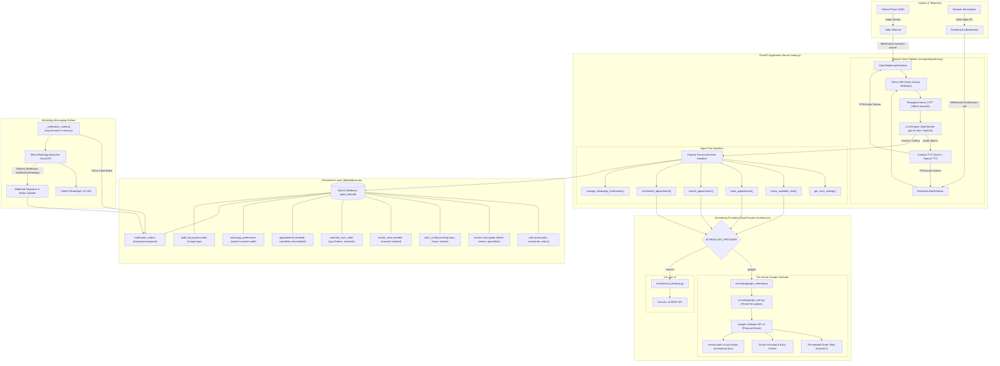

# Automated Voice Agent: Tech Stack & System Architecture

This document provides a comprehensive technical inventory of the current technology stack, subsystem interactions, security boundaries, and end-to-end architecture for the `Automated_Voice_Agent` production repository.

---

## 1. High-Level System Architecture



---

## 2. Complete Technology Stack Inventory

### 2.1 Core Runtime & Web Framework
| Technology | Version / Spec | Role & Functionality |
| :--- | :--- | :--- |
| **Python** | `3.11.x` | Primary programming language runtime. |
| **FastAPI** | `>=0.110.0` | High-performance async ASGI web framework for WebSockets, REST APIs, and webhooks. |
| **Uvicorn** | `>=0.29.0` | Production ASGI web server running with standard event-loop optimizations. |
| **WebSockets** | `>=12.0` | Low-latency bi-directional binary audio streaming. |
| **HTTPX** | `>=0.27.0` | Asynchronous HTTP client for Google Calendar, Cal.com, Meta WhatsApp, and AI provider APIs. |
| **Pydantic** | `>=2.7.0` | Data schema validation and model parsing. |
| **Dotenv** | `>=1.0.0` | Environment configuration loading (`.env`). |
| **Loguru** | `>=0.7.2` | Structured, contextual, colorized logging across all asynchronous tasks. |

---

### 2.2 Voice & AI Pipeline Infrastructure
| Component | Engine / Model | Details & Configuration |
| :--- | :--- | :--- |
| **Pipeline Framework** | **Pipecat AI** (`>=0.0.50`) | Unified frame-based conversational voice orchestration managing VAD, STT, LLM context, and TTS queues. |
| **VAD (Voice Activity Detection)** | **Silero VAD** | Deep-learning speech detector tuned for natural conversational turn-taking (`start_secs=0.08`, `stop_secs=0.25`, `confidence=0.7`). |
| **STT (Speech-to-Text)** | **Deepgram Nova-2** | Ultra-low latency automatic speech recognition ingesting 16,000 Hz single-channel `linear16` PCM audio. |
| **LLM Reasoning & Orchestration** | **OpenRouter / OpenAI** (`gpt-4o-mini`) | Conversational brain executing system instructions, conversational persona, and tool invocation with low response latencies. |
| **TTS (Text-to-Speech)** | **Cartesia Sonic** *(Primary)*<br>**OpenAI TTS** *(Fallback)* | High-fidelity conversational voice synthesis streaming 16kHz audio frames in sub-150ms. |
| **Audio Serializers** | **Custom Python Handlers** ([`audio_helpers.py`](file:///Users/amanpausker/Automated_Voice_Agent/src/utils/audio_helpers.py)) | Converts incoming telephony μ-law/linear16 frames and browser Float32 Web Audio chunks to standardized Pipecat audio frames. |

---

### 2.3 Telephony & Interface Channels
| Channel | Implementation | Operational Details |
| :--- | :--- | :--- |
| **Telecom Carrier** | **Vobiz Media Streams** | Inbound SIP/DID calls receive XML instructions connecting to `/ws/vobiz-stream` for full-duplex conversational streaming. |
| **Web Audio Dashboard** | **Native Web Audio API** | Zero-cost developer console at `/dashboard` connecting to `/ws/browser-call` using browser microphone and speakers. |
| **REST API** | **FastAPI Router** | Public endpoints for `/availability`, `/appointments`, `/clinic-info`, `/doctors`, `/oauth/google/*`, and `/webhooks/*`. |

---

### 2.4 Scheduling & Calendar Engines (Dual-Provider Architecture)
The application implements an environment-switchable scheduling engine controlled via `SCHEDULING_PROVIDER`:

#### Provider 1: Per-Doctor Google Calendar (Personal Gmail Accounts)
* **Libraries:** `google-api-python-client>=2.120.0`, `google-auth>=2.28.0`, `google-auth-oauthlib>=1.2.0`, `google-auth-httplib2>=0.2.0`.
* **OAuth 2.0:** Authorization code grant (`access_type=offline`, `prompt=consent`) supporting doctors' personal `@gmail.com` accounts.
* **Slot Seeding:** Rolling 30-day seeder creates transparent green availability slots (`colorId = 2`, Sage) on doctors' personal calendars respecting clinic working days, open/close hours, break windows, and holidays.
* **Deterministic Event IDs:** Event IDs generated via `hashlib.sha256(f"{doctor_id}:{slot_start}".encode()).hexdigest()[:32]` to guarantee idempotency.
* **Zombie Slot Protection:** Slots deleted or modified directly by doctors in Google Calendar are marked as `removed` in `doctor_slots` and **never resurrected**.
* **Live Conflict Prevention:** Slots are verified against live personal/busy calendar events and guarded by in-memory process-local locks (`asyncio.Lock` keyed by `doctorId:slotStart`).
* **Real-time Push Sync:** Subscribes to `events.watch` webhooks and processes incremental changes using Google `syncToken` (with fallback on HTTP 410 Gone).

#### Provider 2: Cal.com API v2
* **Integration:** Direct async REST integration with Cal.com v2 endpoints (`/slots/available`, `/bookings`, `/event-types`) providing complete fallback compatibility.

---

### 2.5 Security, Cryptography & Privacy
| Security Control | Implementation | Purpose |
| :--- | :--- | :--- |
| **At-Rest Token Encryption** | **Fernet (AES-128-CBC + HMAC-SHA256)** via `cryptography>=42.0.0` | Doctor OAuth refresh tokens are encrypted at rest using `GOOGLE_TOKEN_ENCRYPTION_KEY`. Plaintext tokens are never stored or logged. |
| **Webhook Signature Verification** | **HMAC-SHA256** | Validates `X-Hub-Signature-256` headers on incoming Meta WhatsApp webhooks using timing-safe comparisons (`hmac.compare_digest`). |
| **Healthcare Privacy & PHI** | **Prompt & Code Guards** | WhatsApp templates are strictly stripped of symptoms, clinical notes, and medical diagnoses. Only logistics (date, time, doctor, clinic) are transmitted. |
| **Explicit Consent Engine** | **TCPA / WhatsApp Compliance** | Consent is never inferred from caller ID. The voice agent must obtain explicit caller opt-in before queueing notifications. |

---

### 2.6 Persistence Layer (SQLite & Transactional Outbox)
* **Engine:** SQLite 3 ([`db/agent_data.db`](file:///Users/amanpausker/Automated_Voice_Agent/db/database.py)) using `sqlite3.Row` and WAL-compatible immediate transactions.
* **Migration Strategy:** Additive, idempotent schema migrations executed automatically inside `init_db()` preserving existing tables.
* **Schema Topology:**
  1. `calls`: Call identifiers, caller IDs, audio status, transcripts, summaries, timestamps.
  2. `doctors`: Doctor IDs, names, emails, encrypted refresh tokens, calendar IDs, color mappings, slot durations, timezones, specialties, statuses (`active`, `needs_reconnect`).
  3. `clinic_config`: Operating schedules, working days (`[1,2,3,4,5,6]`), open/close times (`09:00`-`18:00`), break windows (`13:00`-`14:00`), holidays, timezones.
  4. `doctor_slots`: Granular seeded slot tracking (`seeded`, `removed`, `booked`).
  5. `calendar_sync_state`: Incremental sync tokens, push notification channel IDs, and expirations.
  6. `appointments`: Master appointment registry tracking Google Event IDs, caller metadata, patient details, and statuses (`booked`, `cancelled`, `rescheduled`).
  7. `bookings`: Historical Cal.com bookings table.
  8. `whatsapp_preferences`: Caller opt-in/opt-out audit history (`consent_source`, `consent_text_version`, `updated_at`).
  9. `notification_outbox`: Transactional outbox table for resilient WhatsApp messaging with exponential retry backoff.
  10. `audit_log`: System-wide audit logs capturing bookings, reschedules, cancellations, sync runs, and token refresh events.

---

### 2.7 Messaging & Notifications
* **Channel:** Meta WhatsApp Cloud API (Graph API `v21.0`).
* **Delivery Pattern:** **Transactional Outbox Worker** (`_notification_worker` running continuously in FastAPI `lifespan`).
* **Resilience:** Claim batches using `BEGIN IMMEDIATE` transactions, stale lock reclaiming after 5 minutes, exponential retry intervals, and terminal error dead-lettering.
* **Supported Events:** `BOOKED`, `RESCHEDULED`, `CANCELLED`.

---

## 3. Subsystem Interaction Flows

### 3.1 Inbound Voice Call & Scheduling Flow
```
Caller (Phone / Browser)
   │
   ├─► 1. Inbound Call Stream connects to FastAPI WebSocket
   │      - Caller ID identified -> caller profile retrieved (src/user/user_service.py)
   │      - Aura receptionist greeting triggered
   │
   ├─► 2. Caller asks: "What are your clinic hours?"
   │      - Silero VAD detects user utterance
   │      - Deepgram Nova-2 transcribes speech to text
   │      - LLM executes tool: get_clinic_timings()
   │      - Aura speaks natural language timings (e.g. "Monday to Saturday, 9 AM to 6 PM")
   │
   ├─► 3. Caller asks: "Can I see Dr. Smith this Friday?"
   │      - LLM executes tool: check_available_slots(doctor_or_specialty="Dr. Smith", date="2026-10-16")
   │      - If Google Calendar Mode:
   │          * Live events queried via Google Calendar API v3
   │          * Overlapping personal events & blocked slots filtered out
   │          * Returns up to 3 conversational slots (e.g., 10:00 AM, 11:30 AM, 3:00 PM)
   │
   ├─► 4. Caller selects a time & agrees to WhatsApp updates
   │      - LLM executes tool: manage_whatsapp_notifications(enabled=True)
   │      - LLM reads back confirmation: patient name, doctor, date, and time
   │      - LLM executes tool: book_appointment(...)
   │      - Google Calendar:
   │          * Process-local lock acquired on doctorId:slotStart
   │          * Live slot converted to opaque appointment event
   │          * Appointment persisted in SQLite 'appointments' table
   │          * WhatsApp template queued in 'notification_outbox'
   │
   └─► 5. Audio Response Streamed
          - Cartesia Sonic streams voice response back to caller:
            "Your appointment with Dr. Smith is booked for Friday at 10 AM. A WhatsApp confirmation has been queued."
```

---

### 3.2 Doctor Google Calendar Synchronization Flow
```
Doctor (Personal Gmail Calendar)
   │
   ├─► Action A: Doctor deletes or shortens a green "Available" slot on their phone
   │      │
   │      ├─► Google pushes webhook event to POST /webhooks/google/calendar
   │      ├─► Server executes incremental sync via syncToken
   │      ├─► Slot marked as 'removed' in 'doctor_slots' table
   │      └─► Nightly seeder respects 'removed' state and NEVER resurrects the slot
   │
   └─► Action B: Doctor creates personal event (e.g. "Emergency Surgery" 2:00 PM - 4:00 PM)
          │
          ├─► Live availability check detects opaque event intersection
          └─► Green slots between 2:00 PM and 4:00 PM are dynamically hidden from voice callers
```

---

## 4. Repository File Organization

```
Automated_Voice_Agent/
├── .env                              # Active deployment environment secrets
├── .env.example                      # Template documenting all required environment variables
├── requirements.txt                  # Python dependencies
├── main.py                           # FastAPI application entrypoint, webhooks, REST routes, lifespan workers
├── README.md                         # Project documentation and setup instructions
├── TECH_STACK_AND_ARCHITECTURE.md    # System architecture and complete tech stack reference
│
├── db/
│   ├── agent_data.db                 # SQLite database file
│   └── database.py                   # DB migrations, connection management, table accessors
│
├── src/
│   ├── agent/
│   │   ├── pipeline.py               # Pipecat pipeline setup (VAD, STT, LLM, TTS, FunctionSchema tools)
│   │   └── prompts.py                # Conversational persona prompts and guidelines
│   │
│   ├── tasks/
│   │   ├── cal_booking.py            # Cal.com v2 scheduling integration
│   │   └── google_calendar.py        # Per-doctor Google Calendar slot seeding, availability, booking, sync
│   │
│   ├── user/
│   │   └── user_service.py           # Returning caller lookup and profile personalization
│   │
│   └── utils/
│       ├── audio_helpers.py          # Vobiz telephony & Browser Web Audio serializers
│       ├── google_auth.py            # OAuth 2.0 flow, Fernet token encryption, credential refresh
│       └── whatsapp.py               # WhatsApp Cloud API client, outbox processor, webhook verifier
│
└── tests/
    ├── test_whatsapp_notifications.py# Unit tests for WhatsApp preferences, templates, outbox queue
    └── test_google_calendar.py       # Unit tests for slot generation, seeding idempotency, live availability, 409 conflict
```

---

## 5. Verification & Test Suite

The test suite runs hermetically with isolated in-memory SQLite instances and mocked external providers:

```bash
# Run the entire test suite
.venv/bin/python -m unittest discover tests
```

* **Coverage Areas:**
  - WhatsApp notification queuing, exponential backoff, template formatting, webhook verification.
  - Doctor slot candidate generation (working days, break windows, holidays, timezones).
  - Slot seeding idempotency (0 duplicates, no resurrection of doctor-deleted slots).
  - Live availability intersection with opaque/personal doctor events.
  - Double-booking prevention (HTTP 409 conflict on duplicate bookings).
  - Appointment cancellation, rescheduling, and slot reopening.
  - OAuth token refresh failure handling (`invalid_grant` status updating to `needs_reconnect`).
